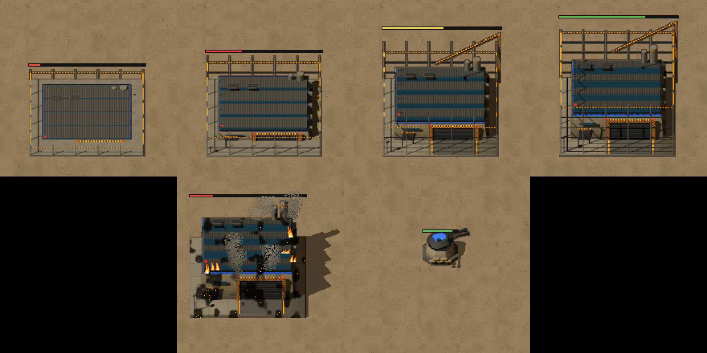
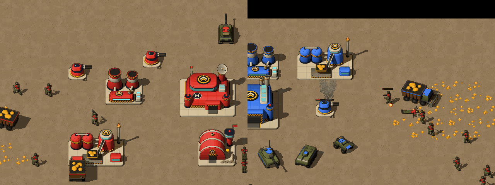

# Rustfront (working title)

An original RTS for open-rts: a desert industrial faction with chunky buildings
painted in the team colour and drab vehicles with team markings, in the spirit
of the late-90s pre-rendered RTS look.
Its units are modelled in Scener, rendered to sprites, packed to 256 colours,
and loaded by its own open-rts binary.

| Buildings | Vehicles | Infantry |
|---|---|---|
| Command Center (3x3), Power Plant (2x2), Ore Refinery (3x2), Barracks (2x2), War Factory (3x3), Gun Turret (1x1, rotating head) | Scout Buggy, Battle Tank (rotating turret), Self-propelled Artillery, Ore Harvester, APC (rotating turret) | Rifleman, Rocket Soldier (idle, walk, fire, die) |


- `art/render.sh` renders the previews above.
- `art/sprites.py` renders the game sprites into `sprites/`: 16 facings for
  vehicles, 8 for animated infantry, separate turret layers, team-colour masks and ground shadows, with
  pivots in `sprites.json`.
- `art/pack8.py` turns them into 256-colour PCX sheets in `assets/` with one shared
  palette and team ramps, plus `sprites.inc` for the C side.
- `art/contact.py` composites them as a check (`art/previews/sprites_contact.png`).






## Play

```sh
make build/bin/rustfront
build/bin/rustfront                    # menu, then Start Game
build/bin/rustfront --map maps/skirmish.txt
env SDL_VIDEODRIVER=dummy build/bin/rustfront --check
```

One skirmish map (`maps/skirmish.txt`, 48 x 30 cells): Blue (you) top left, Red
(the computer) bottom right, each with an ore field, and a contested field in the
middle.

**The computer** is the engine's AI (`play/p_ai.c`) playing Rustfront's faction
(`rules.c`):

- **Opening:** a C&C build order of power, barracks and riflemen, then the
  refinery and a second harvester, the War Factory, gun turrets and a first
  armoured group.
- **After the opening:** it keeps two harvesters and two turrets per base, and
  masses a mixed army of riflemen, rocket soldiers, tanks, artillery, APCs and
  scouts, up to 28 units.
- **Attack:** it attacks in waves of 6 to 16 once it matches what it has seen of
  you, and falls back when a wave is outmatched.
- **Building:** its structures rise on scaffolding like yours (`g_ai.c` picks
  sites near its Command Center with a free cell all round).

**Sidebar:**
- **Credits:** the counter at the top.
- **Radar:** the map in small, with team dots and your view; click it to move
  the view.
- **Build list:** the selected structure's products as cameo rows. Dark icons
  are unaffordable or still need a prerequisite. A darkening curtain shows build
  progress.

**Production:**

| Builder | Makes | Needs |
|---|---|---|
| Command Center | Power Plant | — |
| Command Center | Barracks, Ore Refinery | Power Plant |
| Command Center | War Factory | Ore Refinery |
| Command Center | Gun Turret | Barracks |
| Barracks | Rifleman, Rocket Soldier | — |
| War Factory | Scout, Battle Tank, APC, Artillery | — |
| War Factory | Ore Harvester | Ore Refinery |

To build a structure, click its row, then click a clear site: it rises there on
scaffolding over its build time, one structure at a time. Click a unit's row
again to queue more, up to 9. A new refinery arrives with a free harvester.

**Economy:**
- Each side starts with 5000 credits; a map can set its own with
  `credits OWNER N`.
- Every ore cell holds 1000 ore.
- A harvester mines 50 a second up to a load of 500, brings it to the nearest
  refinery, and goes back.
- An idle harvester finds the nearest ore on its own.
- A mined-out cell turns back to sand.

## Code

| File | Role |
|---|---|
| `g_game.c` | Gameplay rows (hit points, speeds, weapons, footprints, turret and shadow sheets), identity and entry points |
| `info.h`, `info.c` | Sprite names, state runs (vehicles: stand, move, fire; infantry: idle, 6-frame walk, fire, death, corpse), mobjinfo |
| `w_rustfront.c` | Text map loader, terrain atlas, and the sprite loader that cuts the packed BMPs into lumps with pivots, turret mounts, rotation slots, team maps and half-alpha shadows |
| `sprites.inc` | Generated by `art/pack8.py`: sheet grids, pivots, mounts and infantry animations |
| `p_prod.c` | The production catalog: costs, build times, makers, prerequisites, icons |
| `hu_rustfront.c` | The sidebar: credits, radar, cameo build rows (the engine's product list does clicks, queues and placement) |
| `g_combat.c` | Shells and rockets: tanks, gun turrets, artillery and rocket soldiers launch a projectile that does its damage on arrival (the artillery's arcs and splashes; rockets trail smoke) |
| `g_build.c` | Construction sites that rise through four stages while their hit points grow; scorched looks below half health |
| `g_mission.c` | Footprints block movement, idle harvesters go to ore, mined cells clear, a refinery brings a harvester; impact puffs and explosions on damage and death |
| `rules.c` | The faction for the computer player: opening build, doctrine, army roster; no fog |
| `g_ai.c` | The computer player's hooks: it places its own structures on roomy sites, and every structure anchors its defence and draws its waves |
| `m_menu.c` | The engine's simple menu |

**Map format:** rows of `.` (sand), `*` (ore) or `#` (gravel) cells, then
`unit NAME OWNER X Y [FACING]` lines. Each `*` cell is an ore deposit. X and Y are the cell (a building's
top-left), and FACING is 0–15, counter-clockwise from east. Owner 0 is the
player and the others are enemies, each in its team colour. An optional
`camera X Y` sets the opening view.

## Regenerating everything

All of Rustfront's art is generated from source in this directory: Scener
prefabs (`art/prefabs/`), a detail kit (`art/kit.xml`), the palette and view
(`art/layout.py`), and Python scripts. Nothing is hand-painted. The generated
files are committed so the game builds without these tools; regenerate them
after changing any of the sources.

**Prerequisites:**
- **Scener** on `PATH`, or set `SCENER=/path/to/scener`. It is in the Orion UI
  repository: `cd ~/Developer/mapview/ui && make build/bin/scener && python3
  apps/scener/deploy.py --prefix "$HOME/.local"` puts it in `~/.local/bin`.
  Rendering needs a GL context; on macOS a terminal is enough.
- **Python 3 with Pillow** (`pip install Pillow`).
- **xmllint** (it ships with macOS).

**One command**, from the repository root, takes about 4 minutes:

```sh
make rustfront-art
make test-rustfront
```

`make rustfront-art` runs `art/build_all.sh`, then relinks the game. In order:

| Step | Script | Makes |
|---|---|---|
| 1 | `art/layout.py`, `art/render.sh` | `art/units.blks` and the review previews in `art/previews/` |
| 2 | `art/effects.py` | Explosions, shells, rockets, smoke, plumes and fire: `sprites/fx_*.png` |
| 3 | `art/sprites.py` | Every unit's sprites: facings, animation frames, team masks, shadows, construction stages and scorched copies (`sprites/*.png`, `sprites/sprites.json`) |
| 4 | `art/icons.py` | The sidebar's build icons: `sprites/icons.png` |
| 5 | `art/pack8.py` | 256-colour PCX sheets in `assets/` and the C tables in `sprites.inc` |
| 6 | `art/contact.py` | `art/previews/sprites_contact.png`, the sprites composited as the game draws them |

A regeneration reproduces the committed game files exactly (every PCX sheet,
`sprites.inc` and `sprites.json`). A few intermediate PNGs in `sprites/` can
differ by a single pixel of GPU rounding.

Each script can also run alone. `python3 games/rustfront/art/sprites.py tank hq`
re-renders just those units; follow it with `pack8.py`, which always repacks
everything. Scratch scenes go to `art/.build/`, which git ignores.

[docs/SCENER.md](docs/SCENER.md) explains how the art is made: conventions,
camera and lighting, animation knobs, infantry, construction and damage, icons,
the 8-bit palette, and how to add a unit. See
[docs/SCENER.md](docs/SCENER.md) for the conventions and pipelines.
