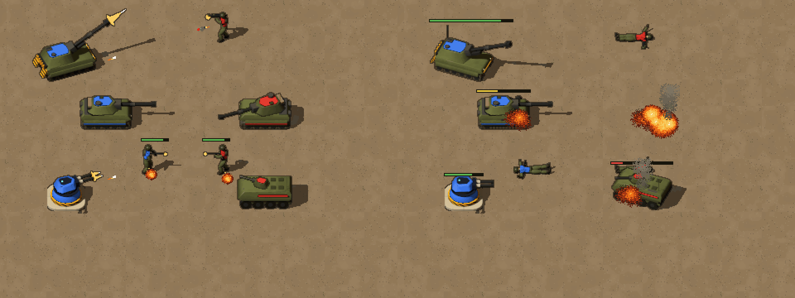

# Rustfront (working title)

An original RTS for open-rts with three factions, in the spirit of the late-90s
pre-rendered RTS look. Like StarCraft's races they share an economy but differ
in look, roster and tempo:

- **Directorate**: chunky industrial buildings painted in the team colour, a
  balanced army with the twin-gunned Mastodon at the top.
- **Scrap Clans**: salvage, rust and corrugated sheet. Cheap, fast and many;
  flamethrowers, gun trucks and rocket rigs; frequent waves.
- **Lumen Concord**: white ceramic, cyan light and hover craft. Few, dear and
  strong; beam weapons, beam towers, late and decisive attacks.
Its units are modelled in Scener, rendered to sprites, packed to 256 colours,
and loaded by its own open-rts binary.

Every faction fills the same roles (`factions.c`): a headquarters (3x3) that builds the
structures, power (2x2), a refinery (3x2, comes with a harvester), a barracks (2x2), a vehicle
factory (3x3) and a turret (1x1, rotating head).

| Faction | Buildings | Vehicles | Infantry |
|---|---|---|---|
| Directorate | Command Center, Power Plant, Ore Refinery, Barracks, War Factory, Gun Turret | Scout Buggy, Battle Tank, Artillery, APC, Mastodon (two guns), Ore Harvester | Rifleman, Rocket Soldier |
| Scrap Clans | Clan Hall, Generator, Smelter, War Camp, Scrap Yard, Spike Tower (twin MG) | Trike, Gun Truck, Scrap Crawler, Rocket Rig (three-rocket salvo), Scrap Hauler | Raider, Torcher (flamethrower) |
| Lumen Concord | Spire, Fusion Core, Extractor, Academy, Foundry, Beam Tower | Skimmer, Glaive, Prism (splashing heavy beam), Hover Harvester | Warden, Lancer |


- `art/render.sh` renders the previews above.
- `art/sprites.py` renders the game sprites into `sprites/`: 16 facings for
  vehicles, 8 for animated infantry, separate turret layers, team-colour masks and ground shadows, with
  pivots in `sprites.json`.
- `art/pack8.py` turns them into 256-colour PCX sheets in `assets/` with one shared
  palette and team ramps, plus `sprites.inc` for the C side.
- `art/contact.py` composites them as a check (`art/previews/sprites_contact.png`).





## Play

```sh
make build/bin/rustfront
build/bin/rustfront                    # menu, then Start Game
build/bin/rustfront --map maps/skirmish.txt        # Directorate against Directorate
build/bin/rustfront --map maps/triad.txt           # you lead the Directorate against the Clans and the Concord
build/bin/rustfront --map maps/triad-clans.txt     # you lead the Scrap Clans
build/bin/rustfront --map maps/triad-concord.txt   # you lead the Lumen Concord
build/bin/rustfront --map maps/badlands.txt        # every terrain, a canyon with ramps, a mesa
build/bin/rustfront --map maps/crossroads.txt      # a multiplayer map: every start a side, you the first
build/bin/rustfront --map maps/campaign/clans-1.txt  # a campaign mission: the Scrap Clans' first
env SDL_VIDEODRIVER=dummy build/bin/rustfront --check
```

One skirmish map (`maps/skirmish.txt`, 48 x 30 cells): Blue (you) top left, Red
(the computer) bottom right, each with an ore field, and a contested field in the
middle.

`maps/badlands.txt` (64 x 44, written by `maps/badlands.py`) shows every terrain and the
relief: a river at the bottom of a canyon, a level below the plain, with ramps down its walls
to two gravel fords; a stone mesa a level above, with one ramp up its south face; grass
meadows, rock outcrops, scrap wrecks, and concrete pads under the Directorate's and the Clans'
bases.

**Multiplayer maps** have neutral starts instead of bases (see [Multiplayer](#multiplayer)):

| Map | Players | Size | Symmetry | Layout |
|---|---|---|---|---|
| Ironbridge (`ironbridge.txt`) | 2 | 64 x 40 | mirrored | a canyon with a river down the middle, three fords with ramps, canyon ore by the outer fords, a mesa of ore in each base's south |
| Mesa Duel (`mesa-duel.txt`) | 2 | 56 x 56 | turned 180° | a mesa of rich ore in the middle with a ramp up each face; silt basins with ponds in the empty corners |
| Three Crowns (`three-crowns.txt`) | 3 | 71 x 64 | mirrored | two bases north, one south, about 52 cells apart each; a plateau with one ramp facing each base; ravines; an expansion between every two bases |
| Crossroads (`crossroads.txt`) | 4 | 72 x 56 | mirrored both ways | a cross of canyons with rivers, fords and a plaza of ore where they meet; a mesa in every quarter; good for 2 v 2 |
| Highland Ring (`highland-ring.txt`) | 4 | 64 x 64 | turned 90° | each base on a highland with two ramps down to a ring of plain; a basin with a lake and ore in the middle |

Each is written by its own script (`maps/ironbridge.py` ...) on `maps/mp.py`, which draws the
terrain and relief, makes the map symmetric and refuses to write it unless every start stands
on flat open ground with room for its force, every start can drive to every other, and every
start has the same ore at the same distance. Rerun a script after changing it.

## Campaign

Fifteen missions, five for each faction, from a tutorial (a headquarters and a squad: build
power, a refinery and a barracks, bank some credits) through raids, sieges and a river
crossing to an all-out assault ([docs/CAMPAIGN.md](docs/CAMPAIGN.md) has the format and the
story). `maps/campaign/missions.py` writes them into `maps/campaign/`.

| | Directorate: The Iron Mandate | Scrap Clans: Rust and Fury | Lumen Concord: The Lumen Path |
|---|---|---|---|
| 1 | Foothold: build up, bank 4000 | Scrap Rights: build up, hoard 3000 | First Light: build up, gather 3000 |
| 2 | Relay Station: protect the relay 5 min | Smash and Grab: burn the depot, keep the Warboss | Shard Recovery: hold the stone ring 90 s |
| 3 | The Ford: hold the ford, burn the War Camp | Junkyard Siege: keep the Hall 6 min | Vigil: keep the Beacon lit 6 min |
| 4 | Glasswater: destroy the Spire on the mesa | Snuff the Light: the gate tower and the Fusion Core | Breaking the Mandate: the War Factory and the Command Center |
| 5 | Iron Dawn: destroy the Clans and the Concord | Scrapfall: raze the Iron Hill | Clear Sky: destroy both, keep the Lens lit |

A mission is a map with mission keys: `mission`, `title`, `briefing`, `objective` (destroy
all, destroy a tagged thing, protect one, survive, hold cells, bank credits, build something),
`tech` (what the player may build), and `trigger`s (timed, on entering cells, on a thing
destroyed, on a build) that `spawn` units, which hunt the player, or show a `message`.
`g_campaign.c` runs them and ends the level through the engine's outcome system
(`G_LevelObjectives`, `G_EndLevel`).

**The front end's API** (`rustfront.h`, 0-based indices):

| Call | Gives |
|---|---|
| `RF_CampaignName(faction)` | "Directorate", "Scrap Clans", "Lumen Concord" |
| `RF_MissionPath(faction, index, out, size)` | the map to load, `maps/campaign/clans-3.txt` |
| `RF_MissionInfo(root, faction, index, &info)` | its title, briefing (paragraphs joined by `\n`) and objectives' text |
| `RF_MissionUnlocked(faction, index)`, `RF_CampaignWon(faction)` | progress: the first mission is open, each win opens the next |
| `RF_CampaignRecordWin(faction, index)`, `RF_CampaignResetProgress()` | write it; a won mission records itself |
| `RF_InMission`, `RF_ObjectiveCount`, `RF_ObjectiveText`, `RF_ObjectiveState`, `RF_LastMissionMessage` | the running mission, for an objectives panel |

Progress is kept in `campaign.txt` under the user directory (`OPEN_RTS_USER_DIR`, else SDL's
pref path). `make test-rustfront` loads every mission and proves each is won by its objectives
and lost by losing; `make test-rustfront-campaign` has a bot play them all for real.

**Terrain** (`art/terrain.txt`, [docs/TERRAIN.md](docs/TERRAIN.md)): each map letter is a
ground type. Silt, sand, gravel, grass, stone, ore and water are procedural textures; rocks,
wrecks and concrete are modelled in Scener. Where two meet, the higher layer spills over the
lower one's edge with a ragged border, the way Dark Reign layers its ground. A map can also
give every cell a height level: where the level changes the ground breaks in a rock cliff
whose face hangs down the screen, as in KKnD, or slopes down a ramp. Water, rocks, wrecks and
cliffs block movement and building.


**The computer** is the engine's AI (`play/p_ai.c`) playing Rustfront's faction
(`rules.c`):

- **Opening:** a C&C build order of power, barracks and riflemen, then the
  refinery and a second harvester, the War Factory, gun turrets and a first
  armoured group.
- **After the opening:** it keeps two harvesters and two turrets per base, and
  masses a mixed army of riflemen, rocket soldiers, tanks, artillery, APCs and
  scouts, up to 28 units.
- **Attack:** it attacks in waves of 6 to 16 once it matches what it has seen of
  you, and falls back when a wave is outmatched.
- **Building:** its structures rise on scaffolding like yours (`g_ai.c` picks
  sites near its Command Center with a free cell all round).

**Sidebar:**
- **Credits:** the counter at the top.
- **Radar:** the map in small, with team dots and your view; click it to move
  the view.
- **Build list:** the selected structure's products as cameo rows. Dark icons
  are unaffordable or still need a prerequisite. A darkening curtain shows build
  progress.

**Production:**

| Builder | Makes | Needs |
|---|---|---|
| Command Center | Power Plant | — |
| Command Center | Barracks, Ore Refinery | Power Plant |
| Command Center | War Factory | Ore Refinery |
| Command Center | Gun Turret | Barracks |
| Barracks | Rifleman, Rocket Soldier | — |
| War Factory | Scout, Battle Tank, APC, Artillery | — |
| War Factory | Ore Harvester | Ore Refinery |

To build a structure, click its row, then click a clear site: it rises there on
scaffolding over its build time, one structure at a time. Click a unit's row
again to queue more, up to 9. A new refinery arrives with a free harvester.

**Economy:**
- Each side starts with 5000 credits; a map can set its own with
  `credits OWNER N`.
- Every ore cell holds 1000 ore.
- A harvester mines 50 a second up to a load of 500, brings it to the nearest
  refinery, and goes back.
- An idle harvester finds the nearest ore on its own.
- A mined-out cell turns back to sand.

## Code

| File | Role |
|---|---|
| `g_game.c` | Gameplay rows (hit points, speeds, weapons, footprints, turret and shadow sheets), identity and entry points |
| `info.h`, `info.c` | Sprite names, state runs (vehicles: stand, move, fire; infantry: idle, 6-frame walk, fire, death, corpse), mobjinfo |
| `w_terrain.c` | The terrain table (`assets/terrain.txt`): map letters, tiles, blocking, ore, the transition overlays, and the relief: levels, cliffs and ramps |
| `w_rustfront.c` | Text map loader, terrain atlas, and the sprite loader that cuts the packed BMPs into lumps with pivots, turret mounts, rotation slots, team maps and half-alpha shadows |
| `sprites.inc` | Generated by `art/pack8.py`: sheet grids, pivots, mounts and infantry animations |
| `p_prod.c` | The production catalog: costs, build times, makers, prerequisites, icons |
| `hu_rustfront.c` | The sidebar: credits, radar, cameo build rows (the engine's product list does clicks, queues and placement) |
| `factions.c` | The three factions: each one's types for the roles (headquarters, power, refinery, barracks, factory, turret, harvester), and which faction a side plays (its headquarters') |
| `g_combat.c` | Projectiles: shells, rockets, beam bolts and flame gouts do their damage on arrival; the Mastodon fires a pair of shells and the Rocket Rig a salvo of three; heavy shells and heavy bolts splash; rockets trail smoke. Machine guns hit at once |
| `g_build.c` | Construction sites that rise through four stages while their hit points grow; scorched looks below half health |
| `g_mission.c` | Footprints block movement, idle harvesters go to ore, mined cells clear, a refinery brings a harvester; impact puffs and explosions on damage and death |
| `rules.c` | Each faction's computer player: the Directorate builds up and attacks at parity, the Clans rush with frequent large waves, the Concord fortifies and attacks late with an edge; no fog |
| `g_ai.c` | The computer player's hooks: it places its own structures on roomy sites, every structure anchors its defence and draws its waves, and a harvester waits while its side has no refinery |
| `w_starts.c` | Multiplayer: start positions, the start plan, `RF_SpawnStart` and the map list |
| `g_net.c` | Lockstep: Rustfront's share of the consistency hash (terrain, blocking, alliances) |
| `s_rustfront.c` | Sound: registers the synthesised samples, maps fire, impacts, deaths, voices and announcements to them, rate-limits the under-attack warning, and plays the ambience and the player's faction's music |
| `g_campaign.c` | The campaign: mission keys, triggers, spawns that hunt the player, objectives, win and loss through `G_LevelObjectives`, progress, the front end's API |
| `m_menu.c` | The engine's simple menu |

**Map format:** rows of terrain letters (`art/terrain.txt`: `.` sand, `:` silt, `*` ore,
`#` gravel, `,` grass, `^` stone, `~` water, `R` rocks, `x` wreck, `=` concrete), optionally
`level ROW` lines, one per row, of height levels `0`–`9` with `/` for a ramp (all 0 when
absent), then `unit NAME OWNER X Y [FACING]` lines. Each `*` cell is an ore deposit. X and Y are the cell (a building's
top-left), and FACING is 0–15, counter-clockwise from east. Owner 0 is the
player and the others are enemies, each in its team colour (blue, red, green,
yellow). A side plays the faction of its headquarters. An optional
`camera X Y` sets the opening view, and `credits OWNER N` a side's money. A `unit` line may
end in `@TAG` to name the thing for a mission, and a campaign mission adds its mission keys
([docs/CAMPAIGN.md](docs/CAMPAIGN.md)).
`title NAME` names the map for the map list, and `start N X Y [FACTION]` marks a neutral start
(see [Multiplayer](#multiplayer)).
`maps/triad.py` writes the three-way maps, `maps/badlands.py` the badlands and
`maps/campaign/missions.py` the campaign.

## Multiplayer

Rustfront plays over the engine's Doom-style lockstep (`driver/d_net.c`): every peer runs the
whole simulation from the same orders, and each tic they compare a hash of the world
(`G_ConsistencyVector`). Rustfront's own state is in it: each projectile's victim and each
site's progress (`MOBJ_GAME_CHECKSUM` in `mobj_data.h`), and every cell's terrain, the blocking
grid and the alliances (`G_ConsistencyExtra` in `g_net.c`).

### Starts and the lobby

A multiplayer map has no bases, only starts:

```
title Crossroads
start 0 7 7 directorate
start 1 62 7 clans
```

`start N X Y [FACTION]` is start N (0-based, without gaps) with its headquarters' top-left cell
at X, Y; FACTION (`directorate`, `clans` or `concord`) is only the default when nobody picks.
The API, in `rustfront.h`:

| Call | Does |
|---|---|
| `int RF_ListMaps(const char *root, rf_mapinfo_t *out, int max)` | Every map in `<root>/maps` (root NULL: the game's): `path` (relative to the root, e.g. `maps/crossroads.txt`), `title`, `players` (starts; 0 for a map with fixed bases), `sides` (owners with units of their own), `width`, `height`. Sorted by players, then title. Reads headers only. |
| `void RF_SetStartPlan(const rf_startplan_t *plan)` | Before loading: `plan->seat[owner]` says which start (`start`, -1: this owner does not play), which faction (`faction`, -1: the start's default) and which team (`team`, 0: alone; owners with the same non-zero team are allies). Kept until changed; NULL brings back the defaults (owner N at start N as its default faction, everyone alone). |
| `int RF_StartCount(void)`, `const rf_start_t *RF_Start(int slot)` | The loaded map's starts: `cell` and default `faction`. |
| `bool RF_SpawnStart(int owner, int faction, int x, int y)` | Places a faction's start with its headquarters at X, Y: the HQ, a harvester (it waits for the refinery), a light vehicle and a squad, facing the middle of the map. Fails, placing nothing, unless the HQ's cells are flat open ground on one level. `RF_LoadThings` calls it for every seat of the plan. |
| `int RF_FactionByName(const char *name)` | `directorate`, `clans`, `concord` to `rf_faction_id_t`; -1 otherwise. |

A map with starts is free-for-all apart from the plan's teams (`level.player_teams`), for the
computer players as well as for `P_IsAlly`. The local player's start sets the opening view.

For a network game, the front end gives every peer the same plan before it loads the map
(the spawned starts are part of the world whose hash `G_NetSignature` sends at the start, so a peer with another plan is refused before the first tic), and seats
the people as owners `0 .. numplayers-1`: `D_PlayerIsHuman` counts seats, and the computer
plays every other owner the plan names. Anything random in the lobby (a random faction or start)
must be drawn once by the host and sent, never drawn by each peer.

### Rules for lockstep-safe code

- Simulation code uses `fixed_t` and integers. Floats only for the view and the HUD.
- No `rand()`, wall-clock time or uninitialised memory in the simulation. Scatter comes from a
  hash of the tic and a mobj id (`g_mission.c`).
- Walk the thinker list, never a list ordered by pointer or by UI selection.
- `consoleplayer` is the local view only: the sidebar, the camera, sounds, results. Never the
  computer player, production or the map.
- State that steers the simulation is hashed: a new mobj field goes in `MOBJ_GAME_CHECKSUM`,
  new level state in `G_ConsistencyExtra`.
- A static cache in simulation code must not outlive a game: a peer that played a game before
  this one must compute the same.

### Desync tests

`tests/rustfront/desync_twins.h` forks two twins that play the same map from the same orders
(given to `G_RunTiccmd` as the network delivers them) and compares their consistency vectors
every tic. The second twin is another local player, has units selected, a different heap and a
game played and thrown away before; none of it may change the world.

- `test_desync`: four minutes of Ironbridge, two people mirrored: building, training,
  harvesting until ore cells run dry, down the ramps into the canyon and up the mesa, and
  fighting across the fords. Two canaries prove that a changed unit, or a changed cell of
  ground, is caught on its tic and in its subsystem.
- `test_desync_four`: Crossroads with two people and two computer players, two minutes
  (`build/bin/tests/rustfront/test_desync_four --long`: four).
- `test_starts`: the map list, every start of every map, plans, teams and empty seats.

## Sound and music

Every sound is synthesised by `art/sfx.py`, in pure Python with no third-party samples.
[docs/AUDIO.md](docs/AUDIO.md) describes the recipes and how the game uses them.
- **Weapons:** rifles, machine guns, cannon, artillery, rockets, flame and beams, heard
  from where they fire.
- **Impacts:** bullet hits, blasts, explosions and collapsing structures, heard where they land.
- **Construction:** a foundation's clunk, scaffold hammering while a site rises, and a
  chime when it finishes.
- **Announcements:** unit ready, structure ready, insufficient funds, low power, and an
  under-attack klaxon at most every 20 seconds.
- **Voices:** a wordless answer to every select, move and attack order, in each faction's
  timbre: the Directorate's clipped military radio, the Clans' gritty loudhailer, the
  Concord's crystalline chimes.
- **Ambience:** wind, and the hum of your headquarters.
- **Music:** looping tracker-style tracks: a menu theme, and in game the track of the
  faction you lead.

`make rustfront-audio` regenerates them in about a minute and relinks the game. The result
is identical every time.

## Regenerating everything

All of Rustfront's art is generated from source in this directory: Scener
prefabs (`art/prefabs/`), a detail kit (`art/kit.xml`), the palette and view
(`art/layout.py`), and Python scripts. Nothing is hand-painted. The generated
files are committed so the game builds without these tools; regenerate them
after changing any of the sources.

**Prerequisites:**
- **Scener** on `PATH`, or set `SCENER=/path/to/scener`. It is in the Orion UI
  repository: `cd ~/Developer/mapview/ui && make build/bin/scener && python3
  apps/scener/deploy.py --prefix "$HOME/.local"` puts it in `~/.local/bin`.
  Rendering needs a GL context; on macOS a terminal is enough.
- **Python 3 with Pillow** (`pip install Pillow`).
- **xmllint** (it ships with macOS).

**One command**, from the repository root, takes about 11 minutes for the three factions:

```sh
make rustfront-art
make test-rustfront
```

`make rustfront-art` runs `art/build_all.sh`, then relinks the game. In order:

| Step | Script | Makes |
|---|---|---|
| 1 | `art/layout.py`, `art/render.sh` | `art/units.blks` and the review previews in `art/previews/` |
| 2 | `art/effects.py` | Explosions, shells, rockets, smoke, plumes and fire: `sprites/fx_*.png` |
| 3 | `art/sprites.py` | Every unit's sprites: facings, animation frames, team masks, shadows, construction stages and scorched copies (`sprites/*.png`, `sprites/sprites.json`) |
| 4 | `art/icons.py` | The sidebar's build icons: `sprites/icons.png` |
| 5 | `art/pack8.py` | 256-colour PCX sheets in `assets/` and the C tables in `sprites.inc` |
| 6 | `art/contact.py` | `art/previews/sprites_contact.png`, the sprites composited as the game draws them |
| 7 | `art/sfx.py` | Every sound effect, voice, ambient loop and music track: `assets/sfx/`, `assets/music/` |

A regeneration reproduces the committed game files exactly (every PCX sheet,
`sprites.inc` and `sprites.json`). A few intermediate PNGs in `sprites/` can
differ by a single pixel of GPU rounding.

Each script can also run alone. `python3 games/rustfront/art/sprites.py tank hq`
re-renders just those units; follow it with `pack8.py`, which always repacks
everything. Scratch scenes go to `art/.build/`, which git ignores.

[docs/SCENER.md](docs/SCENER.md) explains how the art is made: conventions,
camera and lighting, animation knobs, infantry, construction and damage, icons,
the 8-bit palette, and how to add a unit. See
[docs/SCENER.md](docs/SCENER.md) for the conventions and pipelines.
