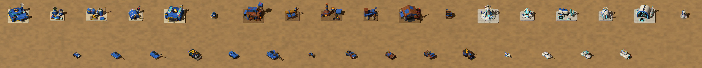

# Rustfront (working title)

An original RTS for open-rts: a desert industrial faction with team-coloured
buildings and vehicles, in the spirit of the late-90s pre-rendered RTS look.
Its units are modelled in Scener, rendered to sprites, packed to 256 colours,
and loaded by its own open-rts binary.

| Buildings | Vehicles | Infantry |
|---|---|---|
| Command Center (3x3), Power Plant (2x2), Ore Refinery (3x2), Barracks (2x2), War Factory (3x3), Gun Turret (1x1, rotating head) | Scout Buggy, Battle Tank (rotating turret), Self-propelled Artillery, Ore Harvester, APC (rotating turret) | Rifleman, Rocket Soldier (idle, walk, fire, die) |



- `art/render.sh` renders the previews above.
- `art/sprites.py` renders the game sprites into `sprites/`: 16 facings for
  vehicles, 8 for animated infantry, separate turret layers, team-colour masks and ground shadows, with
  pivots in `sprites.json`.
- `art/pack8.py` turns them into 256-colour BMPs in `assets/` with one shared
  palette and team ramps, plus `sprites.inc` for the C side.
- `art/contact.py` composites them as a check (`art/previews/sprites_contact.png`).


## Play

```sh
make build/bin/rustfront
build/bin/rustfront                    # menu, then Start Game
build/bin/rustfront --map maps/skirmish.txt
env SDL_VIDEODRIVER=dummy build/bin/rustfront --check
```

One skirmish map (`maps/skirmish.txt`) holds a blue base and force, an ore field
and a red patrol. There is no computer player yet: red only defends itself.

**Sidebar:**
- **Credits:** the counter at the top.
- **Radar:** the map in small, with team dots and your view; click it to move
  the view.
- **Build list:** the selected structure's products as cameo rows. Dark icons
  are unaffordable or still need a prerequisite. A darkening curtain shows build
  progress.

**Production:**

| Builder | Makes | Needs |
|---|---|---|
| Command Center | Power Plant | — |
| Command Center | Barracks, Ore Refinery | Power Plant |
| Command Center | War Factory | Ore Refinery |
| Command Center | Gun Turret | Barracks |
| Barracks | Rifleman, Rocket Soldier | — |
| War Factory | Scout, Battle Tank, APC, Artillery | — |
| War Factory | Ore Harvester | Ore Refinery |

To build a structure, click its row, then click a clear site. Click a unit's row
again to queue more, up to 9. A new refinery arrives with a free harvester.

**Economy:**
- Each side starts with 5000 credits; a map can set its own with
  `credits OWNER N`.
- Every ore cell holds 1000 ore.
- A harvester mines 50 a second up to a load of 500, brings it to the nearest
  refinery, and goes back.
- An idle harvester finds the nearest ore on its own.
- A mined-out cell turns back to sand.

## Code

| File | Role |
|---|---|
| `g_game.c` | Gameplay rows (hit points, speeds, weapons, footprints, turret and shadow sheets), identity and entry points |
| `info.h`, `info.c` | Sprite names, state runs (vehicles: stand, move, fire; infantry: idle, 6-frame walk, fire, death, corpse), mobjinfo |
| `w_rustfront.c` | Text map loader, terrain atlas, and the sprite loader that cuts the packed BMPs into lumps with pivots, turret mounts, rotation slots, team maps and half-alpha shadows |
| `sprites.inc` | Generated by `art/pack8.py`: sheet grids, pivots, mounts and infantry animations |
| `p_prod.c` | The production catalog: costs, build times, makers, prerequisites, icons |
| `hu_rustfront.c` | The sidebar: credits, radar, cameo build rows (the engine's product list does clicks, queues and placement) |
| `g_mission.c` | Footprints block movement, idle harvesters go to ore, mined cells clear, a refinery brings a harvester |
| `rules.c`, `m_menu.c` | No fog, and the engine's simple menu |

**Map format:** rows of `.` (sand), `*` (ore) or `#` (gravel) cells, then
`unit NAME OWNER X Y [FACING]` lines. Each `*` cell is an ore deposit. X and Y are the cell (a building's
top-left), and FACING is 0–15, counter-clockwise from east. Owner 0 is the
player and the others are enemies, each in its team colour. An optional
`camera X Y` sets the opening view.

**Rebuilding the art:**

```sh
python3 games/rustfront/art/sprites.py
python3 games/rustfront/art/icons.py
python3 games/rustfront/art/pack8.py
make build/bin/rustfront test-rustfront
```

`sprites.py` renders the sprites, `icons.py` the build icons, `pack8.py`
converts both to 8-bit BMPs plus `sprites.inc`, and `make` relinks the game and
runs its tests (`tests/rustfront/`). See
[docs/SCENER.md](docs/SCENER.md) for the conventions and pipelines.
