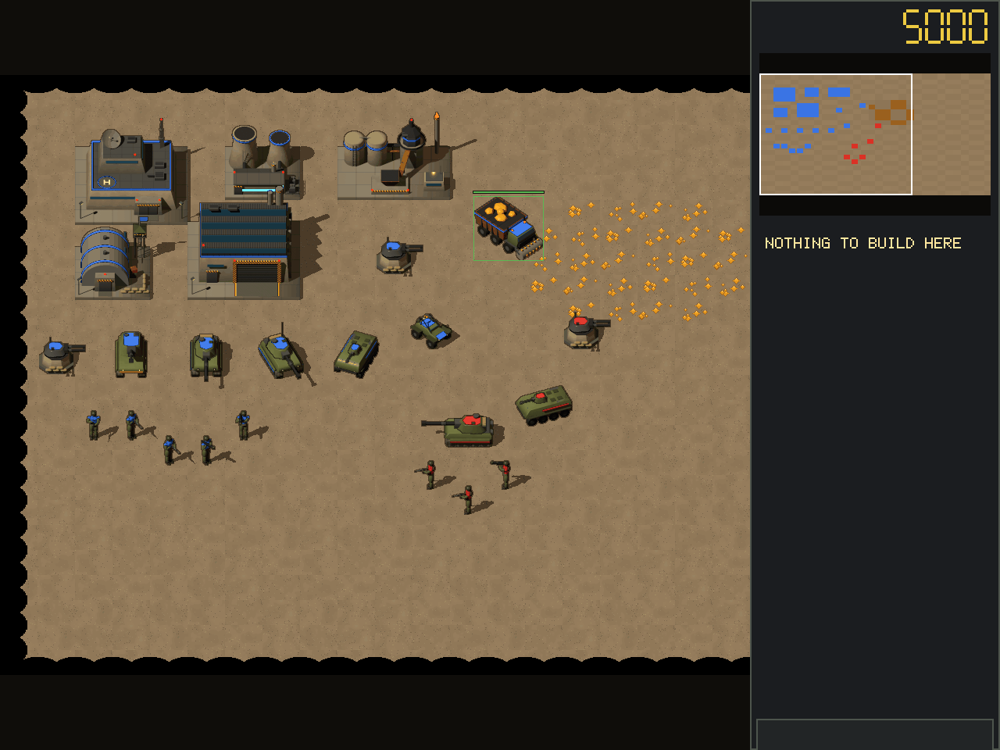
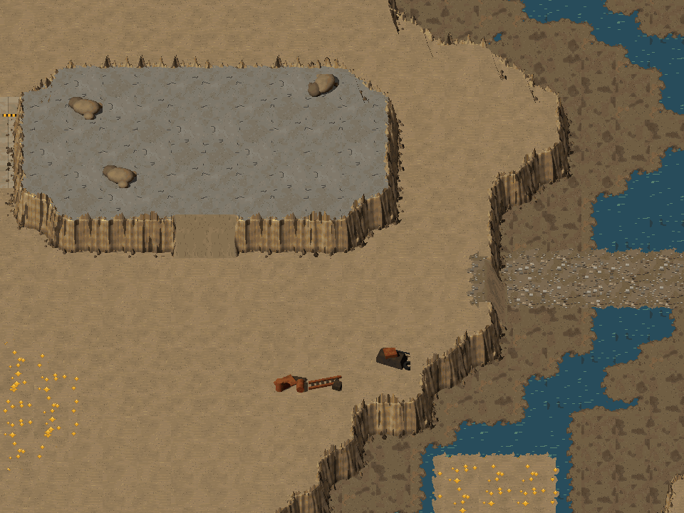

# Rustfront (working title)

An original RTS for open-rts with three factions, in the spirit of the late-90s
pre-rendered RTS look. Like StarCraft's races they share an economy but differ
in look, roster and tempo:

- **Directorate**: chunky industrial buildings painted in the team colour, a
  balanced army with the twin-gunned Mastodon, and the Hammer's long-range missiles at the top.
- **Scrap Clans**: salvage, rust and corrugated sheet. Cheap, fast and many;
  flamethrowers, gun trucks and rocket rigs; frequent waves; Wreckers that drive their
  drums into your base and go up with it.
- **Lumen Concord**: white ceramic, cyan light and hover craft. Few, dear and
  strong; beam weapons, beam towers, late and decisive attacks behind an Aegis's shield.
Its units are modelled in Scener, rendered to sprites, packed to 256 colours,
and loaded by its own open-rts binary.

Every faction fills the same roles (`factions.c`): a headquarters (3x3) that builds the
structures, power (2x2), a refinery (3x2, comes with a harvester), a barracks (2x2), a vehicle
factory (3x3) and a turret (1x1, rotating head). Each also has a tech structure (2x2) that
unlocks its top-tier unit.

| Faction | Buildings | Vehicles | Infantry |
|---|---|---|---|
| Directorate | Command Center, Power Plant, Ore Refinery, Barracks, War Factory, Gun Turret, Uplink Centre | Scout Buggy, Battle Tank, Artillery, APC, Mastodon (two guns), Hammer (missiles), Ore Harvester | Rifleman, Rocket Soldier |
| Scrap Clans | Clan Hall, Generator, Smelter, War Camp, Scrap Yard, Spike Tower (twin MG), Chop Shop | Trike, Gun Truck, Scrap Crawler, Rocket Rig (three-rocket salvo), Wrecker (demolition), Scrap Hauler | Raider, Torcher (flamethrower) |
| Lumen Concord | Spire, Fusion Core, Extractor, Academy, Foundry, Beam Tower (splashing beam), Sanctum | Skimmer, Glaive, Prism (splashing heavy beam), Aegis (shield and repair), Hover Harvester | Warden, Lancer |

**The top tier.** Each tech structure comes from the headquarters once the factory stands,
draws a lot of power, and unlocks one unit at the factory:

| Tech structure | Unit | What it does |
|---|---|---|
| **Uplink Centre** (Directorate, 1500): a team-painted blockhouse under a lattice mast with a big turning satellite dish; it sees 12 cells round the base | **Hammer** (1800): an eight-wheeled carrier with a twin launcher raised toward the front | Fires a pair of heavy missiles that arc and splash, from 11 cells, every 6.5 s; it cannot fire inside 2.5 cells, and sees only 6, so it needs spotters |
| **Chop Shop** (Scrap Clans, 1000): a rusty corrugated garage under a team tarp, a derrick swinging a wrecked car, a fire barrel | **Wrecker** (600): a fast buggy with a spiked ram and a chained stack of explosive drums | Drives into its target and goes up: 500 to the target, half to every other enemy within two cells. Shot dead on the way it still goes up, for a third |
| **Sanctum** (Lumen Concord, 1600): a white ceramic shrine of four leaning fins round a cyan obelisk, under a floating, turning halo | **Aegis** (1400): a broad hover hull with an emitter dish in a crown of fins | Its field (3.5 cells) takes a third off every hit on its side's units and mends their vehicles 12 hit points a second; its own beam is light |


- `art/render.sh` renders the previews above.
- `art/sprites.py` renders the game sprites into `sprites/`: 16 facings for
  vehicles, 8 for animated infantry, separate turret layers, team-colour masks and ground shadows, with
  pivots in `sprites.json`.
- `art/pack8.py` turns them into 256-colour PCX sheets in `assets/` with one shared
  palette and team ramps, plus `sprites.inc` for the C side.
- `art/contact.py` composites them as a check (`art/previews/sprites_contact.png`).




## Play

```sh
make build/bin/rustfront
build/bin/rustfront                    # menu, then Start Game
build/bin/rustfront --map maps/skirmish.txt        # Directorate against Directorate
build/bin/rustfront --map maps/triad.txt           # you lead the Directorate against the Clans and the Concord
build/bin/rustfront --map maps/triad-clans.txt     # you lead the Scrap Clans
build/bin/rustfront --map maps/triad-concord.txt   # you lead the Lumen Concord
build/bin/rustfront --map maps/badlands.txt        # every terrain, a canyon with ramps, a mesa
build/bin/rustfront --map maps/duel.txt            # one against one on point-symmetric ground
build/bin/rustfront --map maps/duel-clans.txt      # you lead the Clans against the Concord
build/bin/rustfront --map maps/duel-concord.txt    # you lead the Concord against the Directorate
env SDL_VIDEODRIVER=dummy build/bin/rustfront --check
```

One skirmish map (`maps/skirmish.txt`, 48 x 30 cells): Blue (you) top left, Red
(the computer) bottom right, each with an ore field, and a contested field in the
middle.

`maps/duel.txt` (56 x 36, written by `maps/duel.py`) is a fair one-against-one: point-symmetric
ground, each base with an ore field beside it and another down its flank, a rich field in the
middle between gravel ridges. The balance harness plays on it.

`maps/badlands.txt` (64 x 44, written by `maps/badlands.py`) shows every terrain and the
relief: a river at the bottom of a canyon, a level below the plain, with ramps down its walls
to two gravel fords; a stone mesa a level above, with one ramp up its south face; grass
meadows, rock outcrops, scrap wrecks, and concrete pads under the Directorate's and the Clans'
bases.

**Terrain** (`art/terrain.txt`, [docs/TERRAIN.md](docs/TERRAIN.md)): each map letter is a
ground type. Silt, sand, gravel, grass, stone, ore and water are procedural textures; rocks,
wrecks and concrete are modelled in Scener. Where two meet, the higher layer spills over the
lower one's edge with a ragged border, the way Dark Reign layers its ground. A map can also
give every cell a height level: where the level changes the ground breaks in a rock cliff
whose face hangs down the screen, as in KKnD, or slopes down a ramp. Water, rocks, wrecks and
cliffs block movement and building.



**Fog of war.** Ground none of your units or structures has seen is black. Ground seen before
but out of sight now is dimmed, and keeps the enemy structures as you last saw them (built,
burning, or long since destroyed) until you look again. Each type sees its own distance: scouts,
trikes and skimmers far, soldiers and heavy guns near, the headquarters and the Uplink Centre
far round the base. Units only shoot what their side sees, so artillery and the Hammer need
spotters. The radar shows the same: black, dimmed, remembered structures, and only the units
you can see.


**Power.** Structures make power (headquarters 30, Power Plant 100, Generator 80, Fusion Core
150) or draw it (a refinery 25–30, a factory 35–50, a turret 10–30, a tech structure 40–60). The
meter at the top left of the sidebar shows drawn / made. When a side draws more than it makes,
its production and construction run at half speed and its turrets fire at half rate, until it
builds more power or sells something.

**Repair and sell.** Select your structures and press **REPAIR** (R): each mends a twentieth of
its hit points a second at half the price of those hit points; press again to stop. **SELL**
(X) takes the selected structures down for half their price, scaled by their health. A wrench
blinks over a structure under repair.

**Rally points.** With a barracks or factory selected, click the ground: a flag marks the spot,
and every unit it finishes drives there.

**Veterancy.** Kills make a unit a veteran (3, one chevron) and then elite (6, two chevrons). A
veteran does a fifth more damage and an elite two fifths more; elite units mend themselves
slowly.

**Controls:**

| Input | Does |
|---|---|
| Left click, drag | Select; with units selected, order them (move, attack what you click) |
| Right click | Deselect |
| Ctrl+1–9, 1–9 | Store a control group, recall it; recall it again to centre the view on it |
| Ctrl+A | Select everything of yours |
| R, X | Repair, sell the selected structures |
| Alt+left, Ctrl+left | Move without attacking, attack-move |
| WASD, arrows, middle drag | Pan |

**The computer** is the engine's AI (`play/p_ai.c`) playing Rustfront's faction
(`rules.c`):

- **Opening:** a C&C build order of power, barracks and riflemen, then the
  refinery and a second harvester, the War Factory, gun turrets and a first
  armoured group.
- **After the opening:** it keeps two harvesters and two turrets per base, and
  masses a mixed army of riflemen, rocket soldiers, tanks, artillery, APCs and
  scouts, up to 28 units.
- **Attack:** it attacks in waves of 6 to 16 once it matches what it has seen of
  you, and falls back when a wave is outmatched.
- **Building:** its structures rise on scaffolding like yours (`g_ai.c` picks
  sites near its Command Center with a free cell all round).
- **Upkeep:** it builds power before anything else when it is short (or within 15 of it), and
  above easy it repairs a structure under 60 % when it has credits to spare. Late in its
  opening it builds its tech structure and fields the top-tier unit.
- **Under the fog:** its picture of your army is only what its units have seen, and its units
  only shoot what they see. Like a classic C&C skirmish computer it knows where your
  structures stand (its waves march on your nearest one unscouted) and notices any enemy
  inside its base's defence radius.
- **Difficulty** (`RF_SetAIDifficulty(owner, RF_AI_EASY | RF_AI_NORMAL | RF_AI_HARD)` in
  `rustfront.h`, set before the game starts): easy collects 40 % less from each load, keeps a
  60 % army and one defence fewer, attacks half as often again with smaller waves and needs a
  bigger edge, and never repairs. Hard collects 30 % more (its only cheat), keeps a 35 %
  larger army and one more defence, attacks sooner with larger waves and at a smaller edge.

**Balance.** `make balance-rustfront` plays the computer against the computer in every faction
pairing on the duel map, 48 games each with the sides swapped and the starting credits varied,
and fails if any faction wins more than 65 % against another (`tests/rustfront/test_balance.c`;
`make test-rustfront` plays one short game per pairing). As tuned, the Directorate wins 57 %
against the Clans and the Concord 57 % against each of the others.

**Sidebar:**
- **Credits:** the counter at the top; the power meter beside it.
- **Radar:** the map in small, with team dots and your view; click it to move
  the view.
- **Build list:** the selected structure's products as cameo rows. Dark icons
  are unaffordable or still need a prerequisite. A darkening curtain shows build
  progress.
- **REPAIR, SELL and the page:** under the list.

**Production:**

| Builder | Makes | Needs |
|---|---|---|
| Command Center | Power Plant | — |
| Command Center | Barracks, Ore Refinery | Power Plant |
| Command Center | War Factory | Ore Refinery |
| Command Center | Gun Turret | Barracks |
| Command Center | Uplink Centre | War Factory |
| Barracks | Rifleman, Rocket Soldier | — |
| War Factory | Scout, Battle Tank, APC, Artillery | — |
| War Factory | Mastodon | Barracks |
| War Factory | Hammer | Uplink Centre |
| War Factory | Ore Harvester | Ore Refinery |

The Clans and the Concord follow the same pattern with their own types: the Chop Shop needs the
Scrap Yard and unlocks the Wrecker; the Sanctum needs the Foundry and unlocks the Aegis.

To build a structure, click its row, then click a clear site: it rises there on
scaffolding over its build time, one structure at a time. Click a unit's row
again to queue more, up to 9. A new refinery arrives with a free harvester.

**Economy:**
- Each side starts with 5000 credits; a map can set its own with
  `credits OWNER N`.
- Every ore cell holds 1000 ore.
- A harvester mines 50 a second up to a load (500; the Scrap Hauler 450), brings it to the
  nearest refinery, and goes back.
- An idle harvester finds the nearest ore on its own.
- A mined-out cell turns back to sand.

## Code

| File | Role |
|---|---|
| `g_game.c` | Gameplay rows (hit points, speeds, weapons, footprints, turret and shadow sheets), identity and entry points |
| `info.h`, `info.c` | Sprite names, state runs (vehicles: stand, move, fire; infantry: idle, 6-frame walk, fire, death, corpse), mobjinfo |
| `w_terrain.c` | The terrain table (`assets/terrain.txt`): map letters, tiles, blocking, ore, the transition overlays, and the relief: levels, cliffs and ramps |
| `w_rustfront.c` | Text map loader, terrain atlas, and the sprite loader that cuts the packed BMPs into lumps with pivots, turret mounts, rotation slots, team maps and half-alpha shadows |
| `sprites.inc` | Generated by `art/pack8.py`: sheet grids, pivots, mounts and infantry animations |
| `p_prod.c` | The production catalog: costs, build times, makers, prerequisites, icons |
| `hu_rustfront.c` | The sidebar: credits, power meter, radar with fog, cameo build rows (the engine's product list does clicks, queues and placement), REPAIR and SELL |
| `factions.c` | The three factions: each one's types for the roles (headquarters, power, refinery, barracks, factory, turret, harvester), and which faction a side plays (its headquarters') |
| `g_combat.c` | Projectiles: shells, rockets, beam bolts and flame gouts do their damage on arrival; the Mastodon fires a pair of shells, the Rocket Rig a salvo of three and the Hammer a pair of heavy missiles; heavy shells, heavy bolts and heavy missiles splash; rockets trail smoke. Machine guns hit at once. The Wrecker's detonation and the Aegis's field |
| `g_base.c` | Power, repair and sell, rally points and veterancy: the orders (`TC_REPAIR`, a move order to a producer) and their rules |
| `g_sight.c` | Fog of war: each type's sight, the fog pass |
| `r_marks.c` | Over each unit: selection, health, rank chevrons, the repair wrench and the rally flag |
| `g_build.c` | Construction sites that rise through four stages while their hit points grow; scorched looks below half health |
| `g_mission.c` | Footprints block movement, idle harvesters go to ore, mined cells clear, a refinery brings a harvester; impact puffs and explosions on damage and death |
| `rules.c` | Each faction's computer player: the Directorate builds up and attacks with an edge, the Clans rush with large waves, the Concord fortifies and attacks late with a clear edge; fog of war with remembered structures |
| `g_ai.c` | The computer player's hooks: it places its own structures on roomy sites, every structure anchors its defence and draws its waves, it keeps its power up and repairs, and plays at a difficulty |
| `m_menu.c` | The engine's simple menu |

**Map format:** rows of terrain letters (`art/terrain.txt`: `.` sand, `:` silt, `*` ore,
`#` gravel, `,` grass, `^` stone, `~` water, `R` rocks, `x` wreck, `=` concrete), optionally
`level ROW` lines, one per row, of height levels `0`–`9` with `/` for a ramp (all 0 when
absent), then `unit NAME OWNER X Y [FACING]` lines. Each `*` cell is an ore deposit. X and Y are the cell (a building's
top-left), and FACING is 0–15, counter-clockwise from east. Owner 0 is the
player and the others are enemies, each in its team colour (blue, red, green,
yellow). A side plays the faction of its headquarters. An optional
`camera X Y` sets the opening view, and `credits OWNER N` a side's money.
`maps/triad.py` writes the three-way maps, `maps/duel.py` the duels and `maps/badlands.py` the
badlands.

## Regenerating everything

All of Rustfront's art is generated from source in this directory: Scener
prefabs (`art/prefabs/`), a detail kit (`art/kit.xml`), the palette and view
(`art/layout.py`), and Python scripts. Nothing is hand-painted. The generated
files are committed so the game builds without these tools; regenerate them
after changing any of the sources.

**Prerequisites:**
- **Scener** on `PATH`, or set `SCENER=/path/to/scener`. It is in the Orion UI
  repository: `cd ~/Developer/mapview/ui && make build/bin/scener && python3
  apps/scener/deploy.py --prefix "$HOME/.local"` puts it in `~/.local/bin`.
  Rendering needs a GL context; on macOS a terminal is enough.
- **Python 3 with Pillow** (`pip install Pillow`).
- **xmllint** (it ships with macOS).

**One command**, from the repository root, takes about 11 minutes for the three factions:

```sh
make rustfront-art
make test-rustfront
```

`make rustfront-art` runs `art/build_all.sh`, then relinks the game. In order:

| Step | Script | Makes |
|---|---|---|
| 1 | `art/layout.py`, `art/render.sh` | `art/units.blks` and the review previews in `art/previews/` |
| 2 | `art/effects.py` | Explosions, shells, rockets, smoke, plumes and fire: `sprites/fx_*.png` |
| 3 | `art/sprites.py` | Every unit's sprites: facings, animation frames, team masks, shadows, construction stages and scorched copies (`sprites/*.png`, `sprites/sprites.json`) |
| 4 | `art/icons.py` | The sidebar's build icons: `sprites/icons.png` |
| 5 | `art/pack8.py` | 256-colour PCX sheets in `assets/` and the C tables in `sprites.inc` |
| 6 | `art/contact.py` | `art/previews/sprites_contact.png`, the sprites composited as the game draws them |

A regeneration reproduces the committed game files exactly (every PCX sheet,
`sprites.inc` and `sprites.json`). A few intermediate PNGs in `sprites/` can
differ by a single pixel of GPU rounding.

Each script can also run alone. `python3 games/rustfront/art/sprites.py tank hq`
re-renders just those units; follow it with `pack8.py`, which always repacks
everything. Scratch scenes go to `art/.build/`, which git ignores.

[docs/SCENER.md](docs/SCENER.md) explains how the art is made: conventions,
camera and lighting, animation knobs, infantry, construction and damage, icons,
the 8-bit palette, and how to add a unit. See
[docs/SCENER.md](docs/SCENER.md) for the conventions and pipelines.
