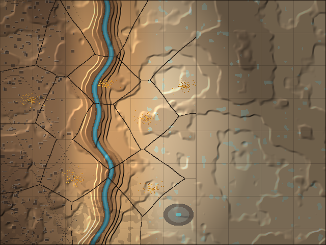

# Rustfront campaign

Three campaigns, one per faction, of five missions each. Every campaign opens with a tutorial
(a headquarters and a squad: learn to build power, a refinery and a barracks, and bank some
credits), grows through raids, sieges and river crossings, and ends in an all-out assault.

```
maps/campaign/missions.py        writes the fifteen missions (python3 games/rustfront/maps/campaign/missions.py)
maps/campaign/<faction>-<n>.txt  the missions: directorate-1 … concord-5
g_campaign.c                     mission keys, triggers, objectives, win and loss, progress, the front end's API
tests/rustfront/test_campaign*.c every mission loads, parses, can be reached, and is won and lost by its rules
```

## The mission format

A mission is an ordinary Rustfront map (cell rows, `level` rows, `unit`, `credits` and
`camera` lines: see the README and [TERRAIN.md](TERRAIN.md)) with mission keys added. The map
loader (`w_rustfront.c`) hands every line it does not know to `g_campaign.c`. A map without a
`mission` line is a skirmish map and plays as before, decided by elimination.

| Key | Meaning |
|---|---|
| `mission FACTION N` | This map is mission N (1–5) of the `directorate`, `clans` or `concord` campaign. |
| `title TEXT` | The mission's name. |
| `briefing TEXT` | One paragraph of the briefing; repeat for more. The front end shows them. |
| `objective KIND ARGS \| TEXT` | Something to do, with the words the player sees after the bar. |
| `tech UNIT...` | The only products the player may build (repeatable). Without a `tech` line everything is allowed; a bare `tech` allows nothing. Products left out are hidden from the sidebar and refused. Enemies are never limited. |
| `trigger NAME time SECONDS [EVERY [TIMES]]` | Fires SECONDS into the mission, then every EVERY seconds, TIMES times in all (0: for ever). |
| `trigger NAME area X Y W H [OWNER]` | Fires once when a unit of OWNER (default the player) enters the W × H cells at X, Y. |
| `trigger NAME destroyed TAG` | Fires once when the tagged thing is destroyed. |
| `trigger NAME built UNIT` | Fires once when the player completes one. |
| `spawn TRIGGER UNIT OWNER X Y [FACING] [@TAG]` | When the trigger fires, the unit appears on that cell. |
| `message TRIGGER TEXT` | When the trigger fires, the text shows in the message log. |
| `unit NAME OWNER X Y [FACING] @TAG` | A placed thing with a tag, for objectives and triggers. |

**Objectives:**

| Kind | Met when |
|---|---|
| `destroy_all` | no enemy unit or structure is left |
| `destroy TAG` | the tagged thing is destroyed |
| `protect TAG` | never met; the mission is lost if the tagged thing is destroyed |
| `survive SECONDS` | that much of the mission has passed (the log counts down the minutes) |
| `hold X Y W H SECONDS` | the player's fighting units have stood in those cells, with no enemy among them, for that long without a break |
| `credits N` | the player has N credits in the bank |
| `build UNIT [COUNT]` | the player has that many of it, finished |

A met objective stays met. The mission is **won** when every objective but `protect` is met,
and **lost** when a protected thing is destroyed or the player has nothing left. A mission
is never won by elimination unless it says `destroy_all`. Win and loss go through the engine's
outcome system: `G_LevelObjectives` calls `G_EndLevel` and leaves only defeat by elimination
to the engine. A win records itself in the campaign's progress.

Enemy units that a trigger spawns **hunt**: they go for the player's nearest unit, and again
whenever they stand idle. Enemies placed with `unit` lines belong to the engine's AI: a side
with a headquarters builds, harvests and attacks as in skirmish (`credits` sets how much it
starts with, which is the main difficulty knob); a side with only structures defends them.

The mission's progress (its clock, triggers, objectives, hunters) is saved with the game.

## The world map

As in Dune 2000, the campaign is played on a map of the Rustfront (`art/worldmap.py` paints it
and cuts it into territories; `m_worldmap.c` draws it). `assets/worldmap.txt` lists:

```
territory ID X Y HOLDER NAME     the territory's seat on the map and who holds it at the start
mission FACTION N TERRITORY      mission N of that campaign is fought there
tint HOLDER R G B AMOUNT%        the holder's colour over its ground
```

Who holds a territory in a campaign follows its progress: the holder at the start, then the
campaign's faction wherever it has won a mission (`RF_TerritoryHolder`); a campaign won takes
the whole map. The front end draws every territory in its holder's colour, lights the selected
mission's borders, and marks the five missions (won, next, locked) with their territories'
names. To place a mission elsewhere, change `MISSIONS` (or `TERRITORIES`) in
`art/worldmap.py` and run it; `test_front` checks every mission has a territory of its own and
that each marker stands in its territory.

| | Directorate | Scrap Clans | Lumen Concord |
|---|---|---|---|
| 1 | Foundry Flats | Hook Wastes | Lumen Reach |
| 2 | Ridge Nine | Rook's Crossing | Saltpan |
| 3 | The Ford | Grand Junkyard | Ashfield |
| 4 | Glasswater | Fallow Mesa | Cinder Bluff |
| 5 | The Crucible | Iron Hill | The Lens |



After a mission the debrief (m_menu.c's `G_ShowOutcome`) names the territory taken or held,
and scores the battle (`RF_Score`, `RF_ScoreRank` in g_mission.c).

## The front end's API

Declared in `rustfront.h`; indices are 0-based.

```c
const char *RF_CampaignName(int faction);                 /* "Directorate", "Scrap Clans", "Lumen Concord" */
bool RF_MissionPath(int faction, int index, char *out, size_t size);   /* "maps/campaign/clans-3.txt" */
bool RF_MissionInfo(const char *root, int faction, int index, rf_missioninfo_t *out);
                                                           /* title, briefing (paragraphs joined by '\n'), objectives */
int  RF_CampaignWon(int faction);                         /* missions won, 0..5 */
bool RF_MissionUnlocked(int faction, int index);          /* the first always; then each after a win */
bool RF_CampaignRecordWin(int faction, int index);        /* the level does this itself on a win */
bool RF_CampaignResetProgress(void);
```

Progress is `campaign.txt` in `D_UserDirectory()` (`OPEN_RTS_USER_DIR`, else SDL's pref path
for open-rts/rustfront): one line per campaign, `clans 3`, the number of its missions won.
Replaying an earlier mission never loses progress.

While a mission runs: `RF_InMission`, `RF_MissionTitle`, `RF_ObjectiveCount`,
`RF_ObjectiveText`, `RF_ObjectiveState` (pending, done, failed), `RF_ObjectiveDetail` (an
objective's terms and how long it has been held), `RF_MissionElapsedMs` and
`RF_LastMissionMessage`, for an objectives panel. To play a mission, load its map path as
any other map.

## Testing

- `test_campaign`: all fifteen load with no bad lines; the mission line matches the file; the
  title, briefing and objectives the front end reads match what the level runs; the player
  plays the campaign's faction; every enemy thing and every ground to hold can be reached on
  foot from the player's start; the tutorials' tech limits hide the War Factory; progress
  opens missions in order and survives replays; a skirmish map is still decided by elimination.
- `test_campaign_directorate`, `_clans`, `_concord`: each mission is won when a script meets
  its objectives (kills what it must, banks the credits, builds what it must, walks into the
  ground to hold and waits), and records the win; it is lost when the protected thing falls
  and when the player's side is wiped out.
- `make test-rustfront-campaign` (minutes, not in the quick suite): a plain bot plays every
  mission for real against the engine AI and the mission's waves. It builds the base in
  order, keeps two harvesters, trains mostly the dearest units it can afford, defends its
  structures, attack-moves on the objective once its army is massed, and orders a unit at
  most every 20 seconds. Every mission must be won by it; it is a floor for difficulty, not
  a measure of it (a person plays far better).
  `RF_CAMPAIGN_TRACE=1` prints its economy and army each minute, `=where` a coarse map of the
  armies, `=blocked` the map's blocked cells, cliffs and ramps.

## The story

Forty years after the collapse, the old foundry belt is a desert of slag, wrecks and dead
rivers: the Rustfront. Now ore has grown in the slag, crystals that hold power, and three
peoples come for it.

- **The Directorate** is what is left of the corporate authority that ran the belt: the
  Mandate, with its Command Centers, its tanks and its order.
- **The Scrap Clans** never left. They live in the wrecks, salvage everything, and answer to
  whoever leads them to the best scrap.
- **The Lumen Concord** came out of the east with white ceramic and cyan light. They believe
  the ore is alive and that the Lens, an ancient device in pieces under the Rustfront, will wake
  it.

### The Directorate: The Iron Mandate

1. **Foothold.** The Commander lands with a Command Center and a rifle squad, raises power and
   a refinery, and banks 4000 credits while scavengers probe the flats. *Tutorial: power,
   refinery, barracks, riflemen.*
2. **Relay Station.** The Clans throw raiders, trikes and finally a war party at the Mandate's
   relay on Ridge Nine. Keep it standing for five minutes until the convoy arrives. *Protect,
   survive; turrets and rocket soldiers.*
3. **The Ford.** The Glass River runs in a canyon; the Clans hold its southern ford. Take the
   ford, hold it a minute, and burn the War Camp on the far bank. *Hold, destroy; the War
   Factory opens.*
4. **Glasswater.** The Concord's Spire on the Glasswater mesa drinks the ore for leagues. One
   ramp leads up, guarded by beam towers; artillery outranges them. *Destroy the Spire.*
5. **Iron Dawn.** The Clans and the Concord have joined against the Mandate. With the Mastodon
   at last, destroy them both. *Destroy all.*

### The Scrap Clans: Rust and Fury

1. **Scrap Rights.** The Warboss of the Hook Clan raises a generator and a smelter, hoards 3000
   credits and runs off the Directorate's surveyors. *Tutorial.*
2. **Smash and Grab.** No base: a war band of raiders, torchers and gun trucks burns the
   Mandate's ore depot at Rook's Crossing. The Warboss rides in a gun truck that must not be
   lost; the gully crew joins halfway. *Destroy, protect.*
3. **Junkyard Siege.** The Mandate comes for revenge. Hold the Grand Junkyard and the Clan
   Hall for six minutes against riflemen, tanks and artillery. *Protect, survive.*
4. **Snuff the Light.** The Concord's light on the Fallow Mesa eats the Clans' ore. Break the
   beam tower at the ramp and destroy the Fusion Core; rocket rigs outrange the towers.
   *Destroy two targets.*
5. **Scrapfall.** Every clan rides behind the Warboss. Raze the Directorate's Iron Hill across
   the canyon. *Destroy all.*

### The Lumen Concord: The Lumen Path

1. **First Light.** The Lightkeeper wakes a Spire, raises a Fusion Core, an Extractor and an
   Academy, and gathers the first ore-light. *Tutorial.*
2. **Shard Recovery.** A shard of the First Lens lies in a ring of standing stones in the
   Saltpan. Take a Glaive and its escort, clear the ring, and hold it for ninety seconds while
   the Clans come back for it. *Hold.*
3. **Vigil.** The shard rests in the Beacon, a beam tower on the Ashfield. Keep it lit for six
   minutes against the Directorate's columns. *Protect, survive.*
4. **Breaking the Mandate.** Destroy the War Factory and the Command Center on Cinder Bluff;
   the Prism is ready. *Destroy two targets.*
5. **Clear Sky.** The Lens is whole, and both the Clans and the Directorate come to stop it
   opening. Destroy them all and keep the Lens tower lit. *Destroy all, protect.*

## Writing a mission

Add a function to `maps/campaign/missions.py` and list it in `MISSIONS`. A `Mission` has the
map's cells and levels (`blob`, `rect`, `plateau` with ramps, `canyon` with fords) and its
things (`unit`, `squad`, `base`, which lays out a faction's base as `maps/triad.py` does).
`header`, `tech`, `objective`, `trigger`, `spawn` and `message` write the mission keys.
`write()` settles one-cell spurs that would sink (see TERRAIN.md), scatters wrecks and rocks
clear of every thing, and checks that every thing stands on open, flat ground away from a cliff,
that no two placed together overlap, and that every tag an objective names is placed. Then:

```sh
python3 games/rustfront/maps/campaign/missions.py
make test-rustfront test-rustfront-campaign
```
