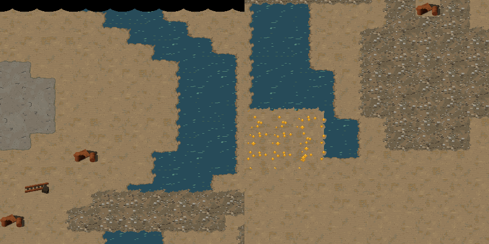

# Rustfront terrain

Rustfront's ground is a set of terrains named in one config file. Each terrain is either a
procedural texture or a tile modelled in Scener, and the config says how terrains blend where
they meet. The scheme follows the layered ground of Dark Reign and Tiberian Dawn (compare
`games/dark-reign/w_map.c`, which draws Dark Reign's own edge tiles the same way).



## Files

```
art/terrain.txt          the config: every terrain, its letter, layer, tiles and blend (hand-written)
art/terrain.py           makes the tiles: texture recipes, Scener renders, transition masks
art/prefabs/terrain/     the modelled tiles: rocks.blk, wreck.blk, concrete.blk
sprites/terrain.png      the RGBA atlas terrain.py writes, with terrain.json
assets/terrain.pcx       the atlas in the game palette (pack8.py)
assets/terrain.txt       GENERATED by pack8.py: the config with atlas indices, read by the game
w_terrain.c              the game side: letters, tiles, blocking, ore, transitions
maps/badlands.py         writes maps/badlands.txt, a map that uses every terrain
```

To rebuild after changing the config, a recipe or a terrain prefab:

```sh
python3 games/rustfront/art/terrain.py     # about 2 s; --no-models reuses the last renders
python3 games/rustfront/art/pack8.py       # repacks every sheet: the palette includes the terrain
make build/bin/rustfront test-rustfront
```

`make rustfront-art` runs both as part of the whole pipeline.

## The config

One line per terrain (`art/terrain.txt` documents every key):

```
terrain sand     .  layer=1  texture=sand     variants=8  seed=100 edge=0.30 jag=0.55 grain=6  rim=0.80
terrain rocks    R  layer=4  model=terrain/rocks     ground=stone variants=4 blocked solid
```

| Terrain | Letter | Made by | Layer | Notes |
|---|---|---|---|---|
| water | `~` | texture | 0 | blocks; the lowest layer, so every land terrain spills onto it |
| sand | `.` | texture | 1 | the default ground; a dark rim where it meets water reads as a wet shore |
| gravel | `#` | texture | 2 | pebbles; fords and spoil |
| grass | `,` | texture | 3 | dry steppe; a ragged, fine-grained fringe |
| stone | `^` | texture | 4 | flat bedrock with cracks and a shaded rim |
| ore | `*` | texture | 5 | sand with crystals; each cell is a deposit, sand when mined out |
| rocks | `R` | Scener | (4) | boulders on stone; blocks; blends as stone |
| wreck | `x` | Scener | (1) | burnt-out scrap on sand; blocks; blends as sand |
| concrete | `=` | Scener | 6 | paved plates under bases; never spills and takes no spill |

A cell picks one of its terrain's `variants` by a hash of its position.

## Textures

`terrain.py` draws a texture tile with a recipe (`RECIPES`): `sand`, `gravel`, `grass`,
`stone`, `water`, `ore`. Every recipe starts from value noise that wraps at the tile edge,
so a field of one terrain has no seams, and adds its own detail: wind ripples, pebbles with a
lit top, grass blades, cracks, ripples on water, ore crystals. A new texture is a new
function in `RECIPES` and a `texture=` line in the config. Keep the colours few: the terrain
shares pack8's 176 free palette colours with every sprite.

## Modelled tiles

A model tile is a Scener prefab of one cell: 200 x 200 cm centred on the origin, the ground
at y = 0, north (the screen's top) at −Z. Its `<let name="v" value="0"/>` knob picks the
variant; `terrain.py` writes a copy per variant and renders them all in one scene with the
game's sprite view (`layout.py`'s yaw and elevation, `sprites.py`'s camera at 4.17 cm per
pixel), so a cell is exactly a 48 x 32 frame.

- With `ground=NAME` the render is a transparent colour pass composited over that terrain's
  texture, plus a shadow pass (the prefab hidden over a white catcher) that darkens the
  ground under it. Keep such a model low and toward the south of its cell: whatever rises
  above the cell's frame is cut off.
- Without `ground` the model must cover the whole cell (`concrete.blk` runs its plates 2 cm
  past it).
- Hide a variant's details by sinking them (`pos="0 {v == 2 ? 0 : -400} 0"`): a group with
  `renderable="0"` would still cast shadows.

## Transitions

Terrains stack by `layer`. A cell draws its own tile, then, lowest layer first, every
terrain of a higher layer among its eight neighbours spills over its edges. A model terrain
with `ground=` spills (and is compared) as its ground; a `solid` terrain takes no spill.

Each spilling terrain has 30 transition tiles, made from its first texture tile:

- **Edge tiles** `edges + m − 1` cover the sides in mask m: N 1, E 2, S 4, W 8.
- **Corner tiles** `corners + m − 1` cover the corners in m: NE 1, SE 2, SW 4, NW 8. A corner
  counts only when neither side beside it is the same terrain, since that side's edge
  already covers it.

A pixel is covered where its distance to the side (or the corner) is under
`edge × (1 + jag × noise)`. The noise wraps with the tile and an edge reaches the same depth
as a corner where they meet, so a spill runs on unbroken from cell to cell; `grain` sets how
fine the raggedness is and `rim` shades its last pixels. Uncovered pixels are index 0, which
the engine leaves transparent.

The game draws them through the engine's transition hook (`MAP_RENDER_CAP_TERRAIN_TRANSITIONS`
and `level.render_transitions`, the hook Dark Reign uses). `level.cell_terrain` holds each
cell's terrain, so a mined-out ore cell that turns to sand changes its neighbours' edges at
once.

## Blocking

`blocked` terrains (water, rocks, wrecks) set `level.blocked` when the map loads, and
`RF_SyncBlocking` (`g_mission.c`) keeps them blocked when it rebuilds the structures'
footprints. Units path around them and nothing can be built on them.
